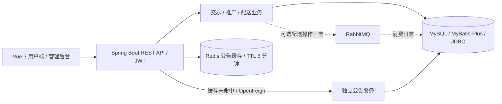
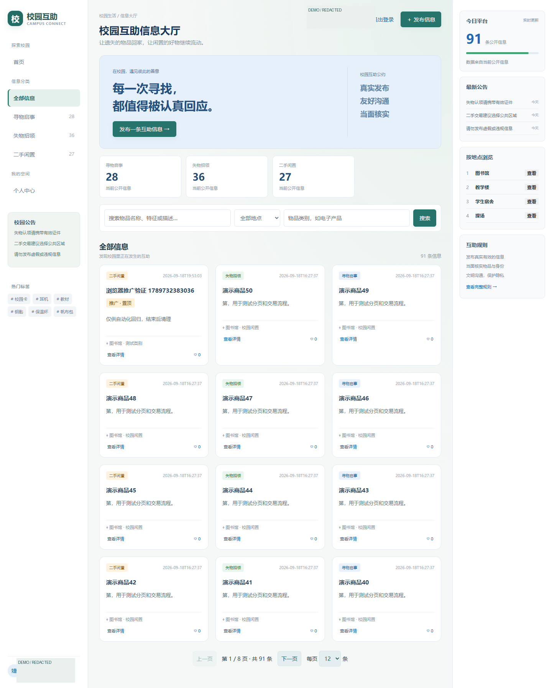
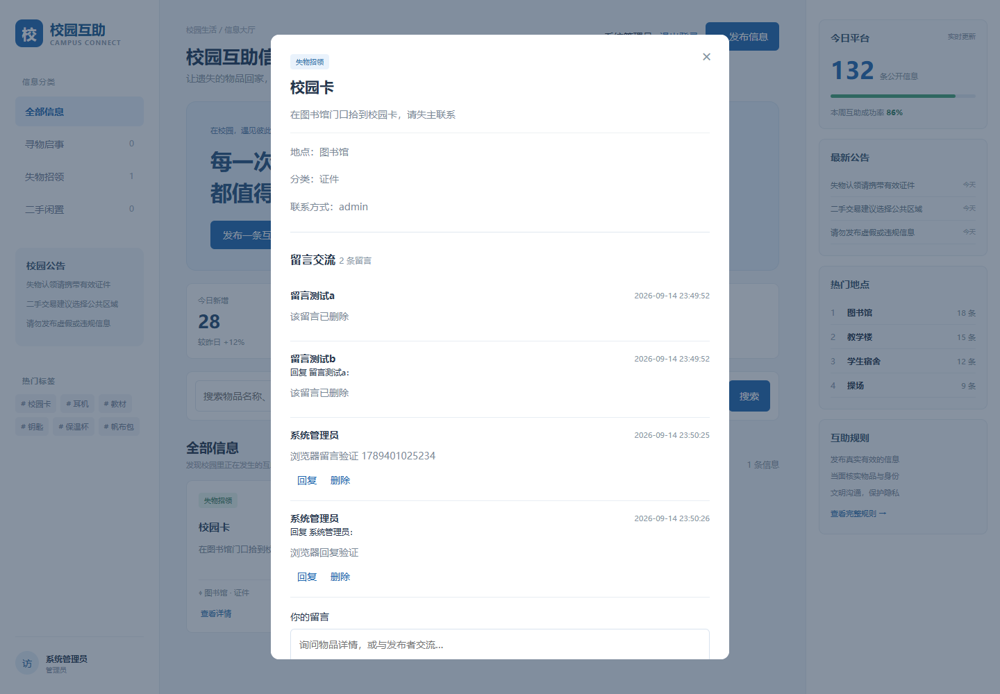
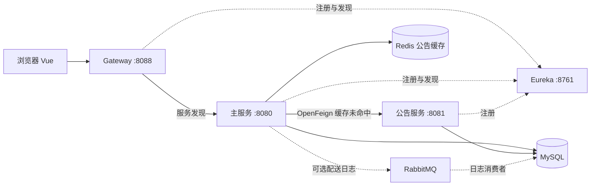

<div align="center">

# Campus Platform · 校园互助平台

## 项目证据与个人贡献

[负责模块与关键技术决策](docs/PORTFOLIO.md) · [当前架构说明](docs/architecture-overview.md) · [持续集成](.github/workflows/ci.yml)



### 演示截图





[截图来源及历史版本说明](docs/images/SOURCES.md)。页面数字属于演示和回归数据。


**连接校园里的失物、闲置与生活服务**


[快速启动](#快速启动) · [技术栈](docs/TECH_STACK.md) · [开发部署](docs/DEVELOPMENT.md) · [接口文档](docs/API.md) · [更新记录](CHANGELOG.md)

</div>

## 项目简介

面向校园的综合互助平台，覆盖失物招领、二手交易、校园配送、物品推广和广告管理。采用 Vue 3 前端、Spring Boot 主服务与独立公告服务，使用 MySQL 持久化业务数据、Redis 缓存公告、RabbitMQ 异步记录配送操作日志。

包含用户端和管理员后台。`v1.0.0` 为首版基线，`master` 持续开发；当前支付为演示流程。

## 功能概览

| 模块 | 当前能力 |
| --- | --- |
| 账号 | 注册登录、JWT 身份验证、个人资料、用户状态管理 |
| 失物与闲置 | 游客搜索筛选、详情、发布、审核、下架、图片上传 |
| 互动 | 物品留言、回复、作者与管理员删除 |
| 交易与运营 | 订单、演示支付、佣金规则、推广订单、平台设置 |
| 校园配送 | 独立需求与关联交易配送、配送员申请审核、接单、履约、纠纷处理 |
| 广告 | 管理员增删改、投放状态、曝光与点击统计 |
| 公告 | 独立服务读取数据库，主服务通过 OpenFeign 调用并缓存 |

## 技术栈

| 层次 | 技术与声明版本 | 实际用途 |
| --- | --- | --- |
| 前端 | Vue `^3.5.13`、JavaScript、CSS | 组件与页面交互 |
| 构建 | Vite `^5.4.11`、plugin-vue `^5.2.1` | 开发服务与静态构建 |
| HTTP | Axios `^1.7.9`、Fetch API | 浏览器请求 |
| 后端 | Java 17、Spring Boot 3.3.13 | REST API、依赖注入、配置 |
| 服务调用 | Spring Cloud BOM 2023.0.6、OpenFeign | 主服务调用公告服务 |
| 服务治理 | Eureka、Spring Cloud Gateway、LoadBalancer（Cloud BOM 管理） | 注册发现、统一 API 入口、按服务名转发 |
| 持久化 | MyBatis-Plus 3.5.7、JdbcTemplate、MySQL | 实体 CRUD 与业务 SQL |
| 缓存 | Spring Cache、Spring Data Redis | 公告缓存，TTL 5 分钟 |
| 消息 | Spring AMQP、RabbitMQ | 配送操作日志异步投递；数据库 outbox 负责失败重试与幂等消费 |
| 认证 | JJWT 0.12.6、PBKDF2-HMAC-SHA256 | JWT 与密码加盐哈希 |
| 工具 | Maven、npm、Lombok 1.18.36、Playwright 脚本 | 构建、代码生成与回归检查 |

详细版本来源、声明但未启用的依赖及架构边界见 [技术栈与架构](docs/TECH_STACK.md)。

## 系统架构



## 快速启动

准备 JDK 17、Maven、Node.js 18+、MySQL 8 和 Redis。RabbitMQ 仅在启用异步日志时需要。

1. 在 MySQL 客户端执行 `backend/src/main/resources/schema.sql` 初始化全新数据库。已有数据库只执行尚未应用的迁移，勿重复初始化。
2. 在两个 Java 服务各自的终端设置数据库密码；默认连接 `localhost:3306/campus_platform`，账号 `root`。

```powershell
$env:DB_PASSWORD = "你的数据库密码"
```

3. 启动 Redis，再在独立终端按顺序启动注册中心、公告服务、主服务和网关：

```powershell
mvn -f registry-service/pom.xml spring-boot:run
```

```powershell
mvn -f notice-service/pom.xml spring-boot:run
```

```powershell
mvn -f backend/pom.xml spring-boot:run
```

```powershell
mvn -f gateway-service/pom.xml spring-boot:run
```

等待 http://localhost:8761 中 CAMPUS-SERVICE、NOTICE-SERVICE、GATEWAY-SERVICE 显示 UP；首次注册和发现可能需要约 90 秒。

4. 启动前端：

```powershell
cd frontend
npm ci
npm run dev
```

访问 `http://localhost:5173`。演示管理员为 `admin / admin123`，仅用于本地演示。

默认 API 地址为 `http://127.0.0.1:8088/api`。环境变量、生产构建、跨域配置和迁移注意事项见 [开发部署指南](docs/DEVELOPMENT.md)。

## 仓库目录

```text
registry-service/ Eureka 注册中心（8761）
gateway-service/  Spring Cloud Gateway（8088）
backend/          主服务、数据库初始化和增量迁移
notice-service/   独立公告服务
gateway-service/  统一 API 网关
registry-service/ Eureka 注册中心
frontend/         Vue 页面、组件和浏览器检查脚本
scripts/          Feign/Redis 联通检查
docs/             技术栈、接口、开发部署及业务说明
DEVELOPMENT_PLAN.md 开发计划与历史记录
CHANGELOG.md      版本与更新摘要
```

## 文档导航

- [技术栈与架构](docs/TECH_STACK.md)
- [开发与部署](docs/DEVELOPMENT.md)
- [API 总览](docs/API.md)
- [配送履约接口](docs/DELIVERY.md)
- [推广接口](docs/PROMOTIONS.md) · [佣金说明](docs/COMMISSION.md)
- [路线图与限制](docs/ROADMAP.md) · [开发计划](DEVELOPMENT_PLAN.md)

## 验证与贡献

```powershell
mvn -f backend/pom.xml test
mvn -f notice-service/pom.xml test
mvn -f gateway-service/pom.xml test
mvn -f registry-service/pom.xml test
cd frontend
npm ci
npm run build
```

Maven 命令成功不等同于真实业务验收；新增 5 项核心 Java 单元测试，覆盖账号安全、令牌失效与佣金金额边界；不等同于数据库或中间件集成验收。浏览器及基础设施检查的依赖和执行方式见开发指南。提交修改时请同步接口文档；数据库变更新增编号迁移，避免修改已部署的迁移文件。欢迎通过 Issues 反馈问题、通过 Pull Request 提交改进。

## 当前边界

支付未接入真实网关；JWT 密钥和撤销列表在进程内，重启后需重新登录；图片存储在本地 `uploads`；Redis/公告服务不可用时没有自动降级。配送日志使用数据库 outbox 重试投递，消费者按 event_id 幂等写入；需要启用 MQ，并监控待投递事件。

未指定开源许可证，默认保留所有权利。
